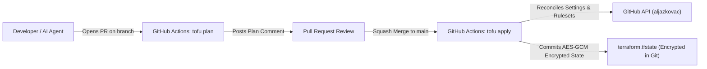

# Architecture & Design Decisions (`github-as-code`)

This document captures the architectural decisions, cryptographic state model, branch protection design for AI coding agents, and operational setup for **`aljazkovac/github-as-code`**.



---

## 1. Why OpenTofu (`tofu`) with Self-Contained Encrypted State?

Managing Infrastructure-as-Code typically requires an external backend (such as HCP Terraform, AWS S3, or Google Cloud Storage) to store `terraform.tfstate` securely because standard Terraform writes state in **plain-text JSON**.

By using **OpenTofu** (the Linux Foundation / CNCF open-source fork of Terraform), we gain **native client-side state and plan encryption** ([`versions.tf`](../versions.tf)) out of the box—allowing `terraform.tfstate` to be safely committed directly to this public GitHub repository with **zero external cloud accounts**.

### How PBKDF2 + AES-GCM State Encryption Works

Think of **PBKDF2** and **AES-GCM** as the two halves of a digital safe that locks and unlocks `terraform.tfstate`:

```text
Your Passphrase ──► [ 1. PBKDF2 ("The Key Maker") ] ──► 256-bit Key ──► [ 2. AES-GCM ("The Safe + Tamper Seal") ] ──► Encrypted terraform.tfstate
```

1. **PBKDF2 (*Password-Based Key Derivation Function 2* — "The Key Maker"):**
   - Encryption algorithms require an exact 256-bit binary key rather than a human-typed passphrase.
   - PBKDF2 takes your `state_encryption_passphrase` (stored locally in git-ignored `terraform.tfvars` and in GitHub Actions Secrets), mixes it with a random salt, and runs it through **600,000 SHA-512 hashing iterations** to derive a 256-bit key. That deliberate slowness makes brute-force guessing impractical.
2. **AES-GCM (*Advanced Encryption Standard – Galois/Counter Mode* — "The Safe & Tamper Seal"):**
   - Uses the 256-bit key from PBKDF2 to encrypt and decrypt `terraform.tfstate` in memory (RAM) during `tofu plan` and `tofu apply`.
   - **AES** scrambles the state contents so anyone browsing the public repository only sees ciphertext (`"encrypted_data": "..."`).
   - **GCM** attaches a cryptographic authentication tag (a tamper-proof seal). If a single byte of the encrypted file is altered or corrupted, OpenTofu detects the tampering immediately and refuses to load it.

---

## 2. Branch Protection Rulesets for an AI-Agent Workflow

When working with autonomous AI coding agents, branch protection rulesets ([`rulesets.tf`](../rulesets.tf)) act as an API-level guardrail on `~DEFAULT_BRANCH` (`main`). Even if an agent runs `git push --force` or attempts to delete a branch, GitHub rejects the operation.

We use three declarative protection tiers in [`repos.tf`](../repos.tf):

| Tier | Repositories | Policy on `~DEFAULT_BRANCH` (`main`) |
| :--- | :--- | :--- |
| **`pr-required`** | `github-as-code`, `eat-and-burn`, `calorie-balance`, `pulse-pipeline` | Blocks branch deletion (`deletion = true`) and force-pushes (`non_fast_forward = true`), enforces linear history (`required_linear_history = true`), and requires a Pull Request (`required_approving_review_count = 0` so solo/agent PRs can merge after CI checks without needing a second human account). Includes **Repository Admin (`actor_id = 5`)** bypass (`bypass_mode = "always"`). |
| **`direct-push`** | `aljazkovac`, `aljazkovac.github.io` | Blocks branch deletion and force-pushes while allowing direct commits to `main` so automated daily RSS feed syncs and blog publishing workflows run uninterrupted. |
| **`none`** | `cockpit`, `playground` | Private repositories (GitHub Free only enforces rulesets on public repositories; if a repository's visibility is changed to `"public"`, OpenTofu automatically provisions its ruleset). |

---

## 3. Repository Catalog & Declarative Imports

- **[`repos.tf`](../repos.tf):** Defines all 8 active repositories in `local.repositories` (`github-as-code`, `aljazkovac`, `aljazkovac.github.io`, `eat-and-burn`, `calorie-balance`, `cockpit`, `playground`, `pulse-pipeline`) with `prevent_destroy = true` so a repository can never be accidentally deleted by OpenTofu.
- **[`imports.tf`](../imports.tf):** Uses declarative `import` blocks to bring pre-existing repositories under OpenTofu management idempotently.

---

## 4. Cloud CI/CD Setup (`GH_PAT` & Secrets)

Locally, `tofu plan` and `tofu apply` authenticate automatically using your active `gh` CLI session and load your passphrase from the git-ignored `terraform.tfvars` file.

For **GitHub Actions** ([`.github/workflows/opentofu.yml`](../.github/workflows/opentofu.yml)) to run `tofu plan` on Pull Requests and `tofu apply` on pushes to `main` across all repositories in your account:

1. **`TF_VAR_state_encryption_passphrase`** *(Already configured)*:
   Stored in `aljazkovac/github-as-code` Actions secrets to decrypt and re-encrypt `terraform.tfstate`.
2. **`GH_PAT`** *(Fine-Grained Personal Access Token)*:
   Because GitHub's default `GITHUB_TOKEN` is scoped only to a single repository, create a [Fine-Grained Personal Access Token](https://github.com/settings/personal-access-tokens/new) scoped to **`All repositories`** with:
   - `Administration`: **Read and write** (manages repository settings, topics, archive states, and branch rulesets)
   - `Contents`: **Read and write** (commits updated encrypted `terraform.tfstate`)
   - `Pull requests`: **Read and write** (posts sticky `tofu plan` comments on PRs)

   Then save it to the repository secrets:
   ```bash
   gh secret set GH_PAT --repo aljazkovac/github-as-code
   ```

